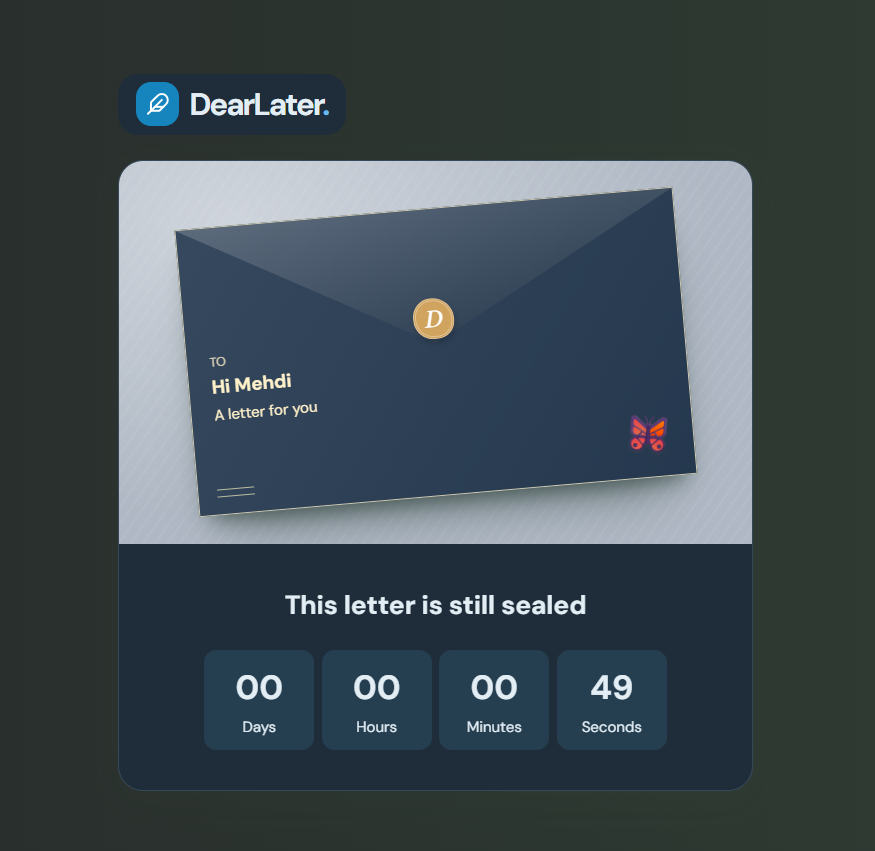

# DearLater

A bilingual Persian / English writing desk for Telegram. Compose a scheduled personal message, send a sealed letter with a server-enforced opening time, or schedule a reminder in Saved Messages.

[راهنمای فارسی](README.fa.md) · [Maintenance notes](MAINTAINERS.txt)

## Run locally on Windows

1. Install **Node.js 24 LTS** (or a newer Node release with node:sqlite). Clone this repository or extract the source archive.
2. Double-click **Start-DearLater.bat**. The first run downloads packages and creates .env.local. Once the app is ready the browser opens at http://127.0.0.1:3000. Close the terminal to stop it.
3. Start in **Local demo**. Choose a time at least two minutes ahead. Save a sealed letter, open it from Outbox before the deadline, keep the tab open, then open the letter when the countdown ends. Demo records do not send messages or simulate actual Telegram delivery.
4. Switch the interface language in the header. Choose the letter language independently. Dates default to Asia/Tehran. Changing the interface language changes the calendar display, not the instant. The outbox shows the 60 most recent records.

Manual startup on any OS: run `npm ci` followed by `npm run dev`. Keep the app bound to loopback. `npm run check` checks TypeScript; `npm run build` creates the production build; `npm start` runs the built app locally. No database installation is required.

## Connect your own Telegram account

Create an application at https://my.telegram.org under **API development tools**. Copy .env.example to .env.local if necessary, enter TELEGRAM_API_ID and TELEGRAM_API_HASH there, and restart the app. Open Settings → Live → Connect. From Telegram on your phone open Settings → Devices and scan the QR displayed by DearLater. Enter the two-step password locally if required. Use a system-wide VPN when needed; a browser extension alone will not route the server's Telegram connection. Keep the QR and session private.

First test Note to self with a time a few minutes ahead. After confirmation, check Telegram's scheduled queue. Next test a message to a consenting personal contact by public username. The confirmation view displays the resolved recipient before delivery. Telegram can reject a request due to privacy rules, account limits, or unsupported dates. For unconfirmed attempts, inspect the Telegram chat and scheduled queue before retrying.

In local-only mode, sealed letters send the cover and local link immediately. An optional second message is scheduled for the unlock time. If only the reminder fails, the outbox records the partial outcome. Links open on the **same PC** while the local app runs. Use Telegram Desktop there to test them. Anyone with the link can read it after the deadline. Pending after an interrupted request means delivery is unknown. There is no automatic resend.

## Local data and future publication

This is a single-owner local test edition, with a separate demo/live selection. Returning to the desk starts in demo mode. App data lives in data/ (SQLite letters and the GramJS session). The Telegram session grants access to the account; use Settings → Live → Revoke session after testing, or terminate the session in Telegram Devices. Never share the data directory, .env.local, or the QR. Data files are excluded from Git. IRANSansX Regular/Bold are supplied for local use, excluded from Git by default. DM Sans is bundled through Fontsource. Confirm your font distribution rights before uploading the Persian font binaries.

This release is not a multi-user service. Before public deployment add per-user authentication and session isolation, protected credential storage, HTTPS envelope URLs, and separate public letter and private desk access. Do not forward this local server to the internet.

## Envelope studio

Choose a stationery edition, palette, ink, addressee, and occasion. Guests see the same design as the composer. New installations start in English, with an independent language for each letter. Local drafts survive refresh. Opening effects respect reduced-motion preferences. While the countdown is visible the letter opens automatically once the server releases the message. Late arrivals open it themselves. Reader text size is adjustable. About DearLater contains the developer credits.

The Windows launcher builds and runs a production instance. Development hot reload is available separately with npm run dev. To upgrade, close the previous instance, extract to a fresh folder, back up and copy the previous data directory and .env.local, then run the launcher. Existing envelopes receive a default design. After editing source for a production run, rebuild with npm run build.

## Public recipient testing from a Windows PC

Close any previous desk on port 3000. Install cloudflared using winget install --id Cloudflare.cloudflared -e or place the official cloudflared.exe beside the launcher. Run Start-Public-Test.bat. It starts an ephemeral, loopback-only reader gateway and a Cloudflare Quick Tunnel, then starts Next on loopback with the assigned HTTPS origin. Keep the terminal open and prevent PC sleep. Use Demo to check an outbox envelope from a second device, then connect Telegram in Live mode for actual delivery. Only reader GET/HEAD requests and assets are published. Never expose the desk port. Stopping the tunnel retires its URL. Reopen an existing letter from the outbox and share its new URL after a restart. This does not enable multiple senders.

## Appearance and reader scenes

Settings → Appearance follows the operating system by default. Light and Dark overrides are stored in the current browser. The chat-inspired interface uses DearLater branding. In Envelope studio, choose the physical left and right page colours independently; the gradient keeps its orientation in both languages. The daylight birthday scene runs from 06:00 until 18:00 in the reader’s device time zone. At night, a starfield and repeating fireworks appear. Effects stop when paused, disabled, or hidden by reduced-motion preferences. Reader tabs suspend the decorative scene while hidden. No media upload is required.

Before pushing to GitHub, run npm ci, npm run check and npm run build. Only add source files after reviewing git status. Keep the personal Telegram session, SQLite database and environment files on your machine. To use the supplied Persian fonts in a fresh checkout, place licensed copies of IRANSansX-Regular.woff2 and IRANSansX-Bold.woff2 in public/fonts/.
